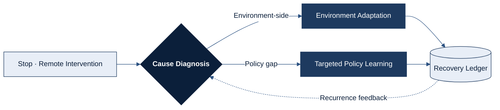
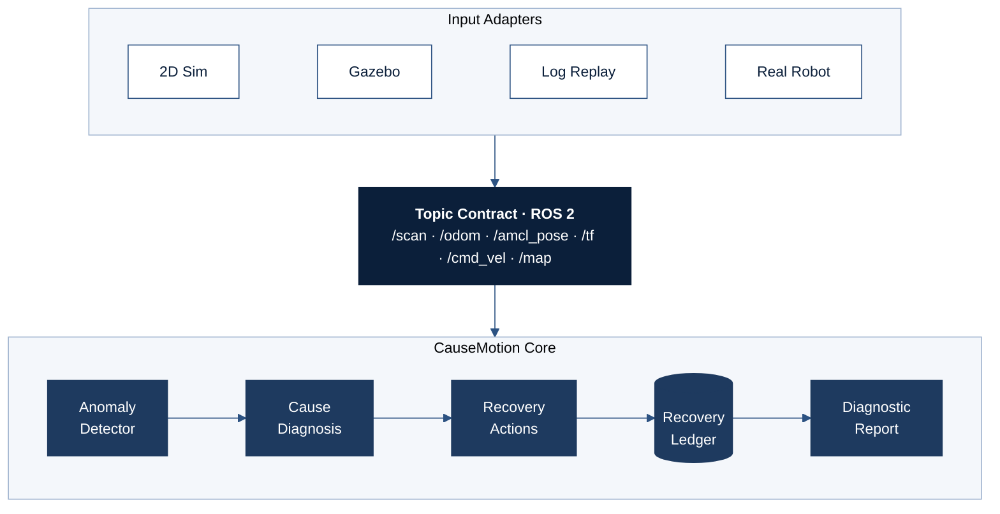
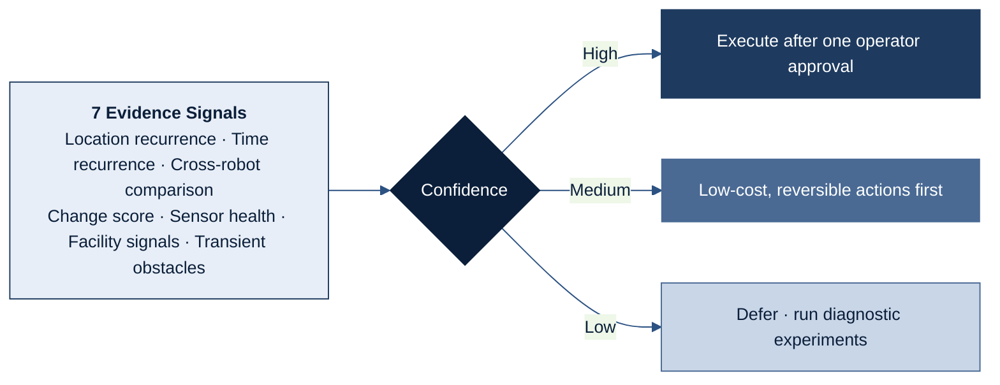
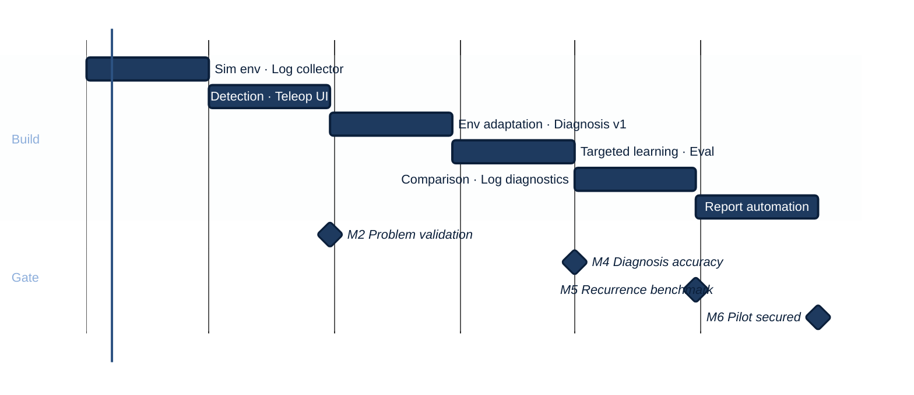

[한국어](README.md) &nbsp;|&nbsp; **English**

# CauseMotion

**Root-Cause-Aware Field Recovery Engine for Service Robots**

An engine that diagnoses why a building service robot stopped and recovers it with the right action: **Environment Adaptation** or **Targeted Policy Learning**

[Overview](#overview) &nbsp;·&nbsp; [Problem](#problem) &nbsp;·&nbsp; [System](#system) &nbsp;·&nbsp; [Diagnosis](#cause-diagnosis) &nbsp;·&nbsp; [Evaluation](#evaluation-plan) &nbsp;·&nbsp; [Roadmap](#roadmap)

---

## Overview

| | |
|:--|:--|
| **Problem** | Building service robots stop repeatedly as their environment changes, and remote-intervention logs are fed into training regardless of the cause. |
| **Approach** | Diagnose the cause of every intervention. Environment-side causes go to **Environment Adaptation**; only policy-side causes go to **Targeted Policy Learning**. |
| **Hypothesis** | A large share of real-world remote interventions stem from causes unrelated to learning (maps, calibration, facilities, transient factors). |

| Recurrence Rate | Diagnosis Accuracy (High) | Diagnosis Accuracy (Overall) |
|:--:|:--:|:--:|
| **▼ 30%+** | **85%+** | **70%+** |
| vs. learning from all interventions · same budget | High-confidence cases | All diagnoses |

Targets are provisional and will be validated through controlled simulation experiments.

---

## Problem

> [!IMPORTANT]
> Of all the reasons a robot stops, **only a policy gap can be fixed by learning.**

| Cause | Typical Case | Right Action | Route |
|:--|:--|:--|:--:|
| Transient | Crowds of pedestrians, temporarily placed objects | Log only | — |
| Outdated Map | Rearranged furniture, events, temporary partitions | Partial map update | Environment Adaptation |
| Sensor Calibration | Misaligned camera or LiDAR mount | Calibration request | Environment Adaptation |
| Facility Integration | Elevator or gate not responding | Facility ticket | Environment Adaptation |
| **Policy Gap** | Repeated avoidance failures in crowded corridors | **Targeted training** | **Targeted Policy Learning** |

Training on the wrong cause does not reduce recurrence. It only raises cost, and noisy data can degrade the policy.

---

## System

### Recovery Pipeline

Each stop is handled as a closed loop: **diagnose → act → record → verify recurrence**.

<table>
<tr>
<th width="50%">Environment Adaptation</th>
<th width="50%">Targeted Policy Learning</th>
</tr>
<tr valign="top">
<td>

| Step | Description |
|:--|:--|
| Change detection | Separate persistent from transient changes |
| Partial map update | Update only the changed zones |
| Zone parameters | Tune clearance and speed locally |
| Calibration · facility tickets | Route to the responsible owner |

</td>
<td>

| Step | Description |
|:--|:--|
| Selection | Only cases diagnosed as policy gaps |
| Review | Exclude low-quality teleoperation logs |
| Targeted training | Train on that scenario type only (HG-DAgger) |
| Before/after check | Target success rate · no regression elsewhere |

</td>
</tr>
</table>

### Architecture

Swap only the input adapter and **the same code runs in simulation and on real robots**.

---

## Cause Diagnosis

Seven evidence signals are combined into ranked cause candidates with a **confidence level**, and the action taken depends on that confidence.

**Design Principles**

| Principle | Description |
|:--|:--|
| Positive evidence | A policy gap is never a residual category; it requires confirmed recurrence in the same scenario type |
| Asymmetric thresholds | Try low-cost, reversible actions even at low confidence; **require the strongest evidence before training** |
| Contamination guard | Always check sensor health before updating a map |
| Sequential fallback | On recurrence, move to the next cause candidate |

---

## Evaluation Plan

Changes are injected in a controlled way in simulation to obtain **ground-truth causes**, and three approaches are compared under the same budget.

| Baseline | Description |
|:--|:--|
| A | Learn from every intervention |
| B | Scheduled inspection · full map rebuilds |
| **C** | **CauseMotion** — cause diagnosis + two-path recovery |

| Metric | Definition | Target (provisional) |
|:--|:--|:--|
| Diagnosis accuracy | Agreement with ground-truth causes | High 85%+, overall 70%+ |
| Recurrence rate | Share of same-zone, same-cause stops after action | 30%+ lower than A |
| Training contamination | Share of trained cases with non-policy causes | Minimize |
| Recovery cost | Teleoperation time · compute · map updates | Measured separately |

> [!NOTE]
> The cause distribution in simulation is set by design, so the core hypothesis cannot be proven in simulation alone. It will be validated through **diagnostics on partner operators' logs**.

---

## Roadmap

Validation is completed within six months without hardware, with a go/no-go decision at each gate.

| Phase | Environment | Goal |
|:--:|:--|:--|
| **1** | 2D Simulation | Inject 5 cause types, diagnosis v1, three-way comparison |
| **2** | Gazebo Harmonic | 3D reproduction, camera-based remote intervention |
| **3** | Real Robot | Real-sensor validation, measure the sim-to-real gap |

---

## Differentiation

| Existing Approach | Scope | CauseMotion |
|:--|:--|:--|
| Teleoperation-learning companies | Use intervention data for training | Select only interventions that need learning |
| Failure-analysis tools | Root-cause analysis for engineers | Connect diagnosis → action → recurrence check |
| Fleet-management platforms | Monitoring · remote control | Cause diagnosis and recurrence prevention after intervention |
| Manufacturer map updates | Map updates for their own robots | Vendor-agnostic; covers causes beyond maps |

> [!TIP]
> **Data Moat** — No public dataset links change, intervention, cause, action, and recurrence the way the Recovery Ledger does.

---

## Tech Stack

| Layer | Stack |
|:--|:--|
| Robotics | ROS 2 Jazzy · Nav2 · Gazebo Harmonic · TurtleBot 4 · HuNavSim |
| Data | rosbag2 (MCAP) · Foxglove |
| Backend | Python · FastAPI · SQLite / PostgreSQL |
| Learning | PyTorch |
| Infra | Ubuntu 24.04 · Docker |

## Getting Started

> Coming soon.

## Data & License

Public datasets are classified and managed by license tier (commercial use / conditional / research only). Raw data is not included in this repository.

---

NAVER D2SF Campus Tech Startup Competition · Proposal v3

