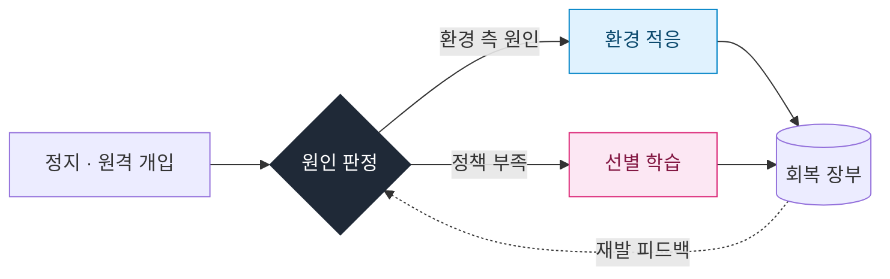
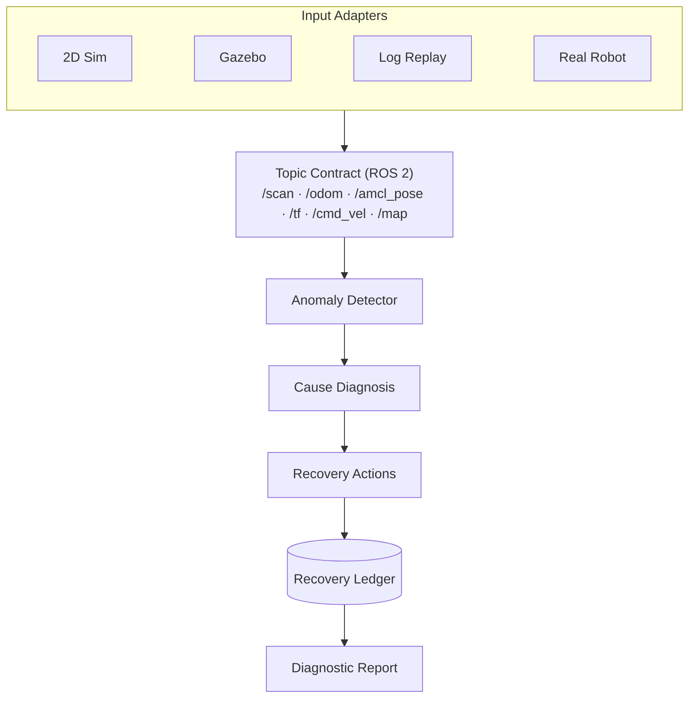
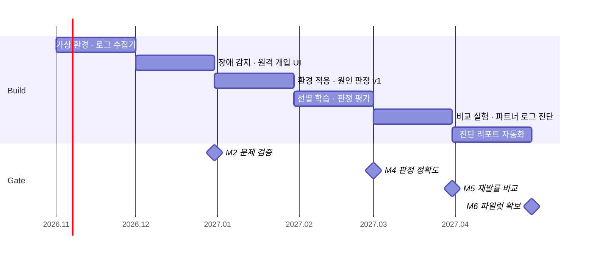

# CauseMotion

**Root-Cause-Aware Field Recovery Engine for Service Robots**

건물 서비스 로봇의 멈춤 원인을 판정해, **환경 적응**과 **선별 학습** 중 맞는 조치로 회복시키는 엔진

[개요](#개요) · [문제 정의](#문제-정의) · [시스템 구조](#시스템-구조) · [원인 판정](#원인-판정) · [평가](#평가-계획) · [로드맵](#로드맵)

---

## 개요

| | |
|:--|:--|
| **Problem** | 건물 서비스 로봇은 환경 변화에 반복적으로 정지하며, 원격 개입 기록이 원인 구분 없이 학습 데이터로 사용된다. |
| **Approach** | 개입마다 원인을 판정해 환경 측 원인은 **환경 적응**으로, 정책 측 원인만 **선별 학습**으로 처리한다. |
| **Hypothesis** | 실제 원격 개입의 상당 부분은 학습과 무관한 원인(지도·보정·시설·일시 요인)이다. |
| **Target** | 동일 예산에서 전체 개입 학습 대비 **재발률 30% 이상 감소** (잠정) |

---

## 문제 정의

로봇 정지의 원인은 다양하지만, 이 중 학습으로 해결되는 것은 **정책 부족** 하나뿐입니다.

| 원인 | 대표 사례 | 적절한 조치 | 처리 경로 |
|:--|:--|:--|:--:|
| 일시 요인 | 보행자 군집, 임시 적치물 | 기록 | — |
| 지도 노후화 | 가구 재배치, 행사, 임시 칸막이 | 지도 부분 갱신 | 환경 적응 |
| 센서 보정 | 카메라·LiDAR 장착 틀어짐 | 보정 요청 | 환경 적응 |
| 시설 연동 | 엘리베이터·게이트 응답 실패 | 시설 티켓 | 환경 적응 |
| **정책 부족** | 혼잡 복도의 반복적 회피 실패 | **표적 학습** | **선별 학습** |

원인과 무관한 학습은 재발을 줄이지 못하고 비용만 늘리며, 노이즈 데이터로 정책 성능을 저하시킬 수 있습니다.

---

## 시스템 구조

### Recovery Pipeline

<table>
<tr>
<th width="50%">환경 적응 · Environment Adaptation</th>
<th width="50%">선별 학습 · Targeted Policy Learning</th>
</tr>
<tr valign="top">
<td>

| 단계 | 내용 |
|:--|:--|
| 변화 감지 | 고정 변화와 일시 변화 구분 |
| 지도 부분 갱신 | 변경 구역만 갱신 |
| 구역별 파라미터 | 여유 거리·속도 국소 조정 |
| 보정·시설 티켓 | 담당 주체에 자동 전달 |

</td>
<td>

| 단계 | 내용 |
|:--|:--|
| 선별 | 정책 부족 판정 건만 후보화 |
| 검수 | 저품질 원격조정 기록 제외 |
| 표적 학습 | 해당 상황 유형만 학습 (HG-DAgger) |
| 전후 검증 | 목표 성공률 · 비목표 성능 유지 |

</td>
</tr>
</table>

### Architecture

모든 모듈은 ROS 2 **토픽 계약**만을 입력으로 사용합니다. 입력 어댑터 교체만으로 동일 코드가 시뮬레이션과 실제 로봇에서 동작합니다.

---

## 원인 판정

7개 근거 신호를 결합해 원인 후보와 **확신도**를 산출하고, 확신도에 따라 조치 수준을 달리합니다.

> 장소 반복 · 시간 반복 · 로봇 간 비교 · 변화 점수 · 센서 상태 · 시설 신호 · 일시 장애물

| 확신도 | 처리 정책 |
|:--:|:--|
| **High** | 조치 제안 → 운영자 1회 승인 → 실행 |
| **Medium** | 저비용·가역 조치부터 실행 후 관찰 |
| **Low** | 판정 보류 → 진단 실험 (시간대·로봇 교체 재주행, 보정 점검) |

**Design Principles**
- 정책 부족은 잔여 범주가 아니라 **적극적 근거**(동일 상황 유형의 반복)가 있을 때만 판정
- 저비용·가역 조치는 낮은 확신에서도 선시도, **학습 투입에는 최고 수준의 근거** 요구
- 지도 갱신 전 센서 상태 확인 필수 (지도 오염 방지)
- 재발 시 차순위 원인 후보로 전환

---

## 평가 계획

시뮬레이션에서 변화를 통제 주입해 **원인 정답(ground truth)** 을 확보하고, 동일 예산 조건에서 세 방식을 비교합니다.

| Baseline | 설명 |
|:--|:--|
| A | 전체 개입 학습 |
| B | 정기 점검 · 지도 재제작 |
| **C** | **CauseMotion** (원인 판정 + 이원 처리) |

| Metric | 정의 | 목표 (잠정) |
|:--|:--|:--|
| 판정 정확도 | 원인 정답 대비 일치율 | High 85%+, 전체 70%+ |
| 재발률 | 조치 후 동일 구역·원인 재발 비율 | A 대비 30%+ 감소 |
| 학습 데이터 오염률 | 학습 투입분 중 비정책 원인 비율 | 최소화 |
| 회복 비용 | 원격조정 시간 · 연산 · 지도 갱신 횟수 | 분리 측정 |

> 시뮬레이션의 원인 분포는 설계값이므로 핵심 가설은 시뮬레이션으로 증명할 수 없습니다. 이는 **파트너 운영사 로그 진단**으로 검증합니다.

---

## 로드맵

| Phase | 환경 | 목표 |
|:--|:--|:--|
| 1 | 2D Simulation | 5개 원인 주입, 판정 v1, 세 방식 비교 |
| 2 | Gazebo Harmonic | 3D 재현, 카메라 기반 원격 개입 |
| 3 | Real Robot | 실센서 검증, Sim-to-Real 격차 측정 |

---

## 차별성

| 기존 접근 | 범위 | CauseMotion |
|:--|:--|:--|
| 원격조정 학습 기업 | 개입 데이터를 학습에 활용 | 학습이 필요한 개입만 선별 |
| 장애 분석 도구 | 엔지니어용 원인 분석 | 판정 → 조치 → 재발 검증까지 연결 |
| 관제 플랫폼 | 모니터링·원격 조작 | 개입 이후의 원인 판정과 재발 방지 |
| 제조사 지도 갱신 | 자사 로봇 지도 갱신 | 제조사 무관, 지도 외 원인까지 구분 |

**Data Moat** — 변화·개입·원인·조치·재발이 연결된 회복 장부 데이터는 공개된 사례가 없습니다.

---

## Tech Stack

| Layer | Stack |
|:--|:--|
| Robotics | ROS 2 Jazzy · Nav2 · Gazebo Harmonic · TurtleBot 4 · HuNavSim |
| Data | rosbag2 (MCAP) · Foxglove |
| Backend | Python · FastAPI · SQLite / PostgreSQL |
| Learning | PyTorch |
| Infra | Ubuntu 24.04 · Docker |

## Getting Started

> 준비 중입니다.

## Data & License

공개 데이터셋은 라이선스 등급(상업 이용 가능 / 조건부 / 연구 전용)으로 분류해 관리하며, 원본 데이터는 본 저장소에 포함하지 않습니다.

---

NAVER D2SF Campus Tech Startup Competition · Proposal v3

