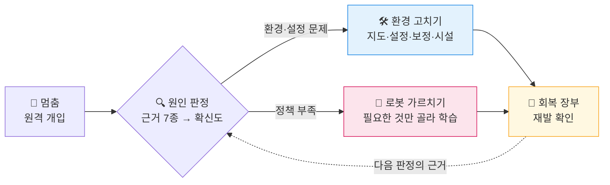
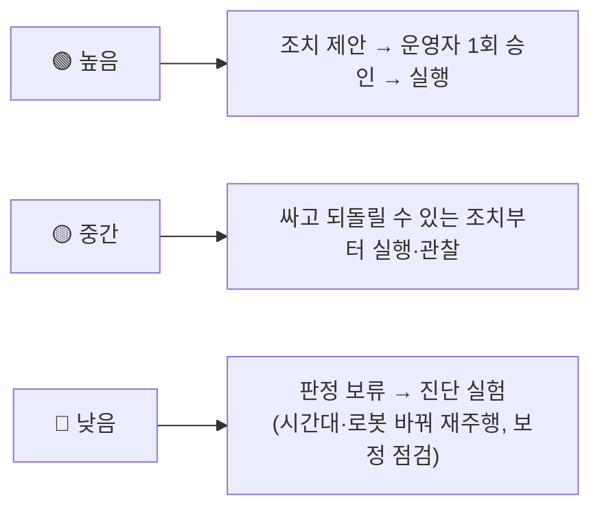
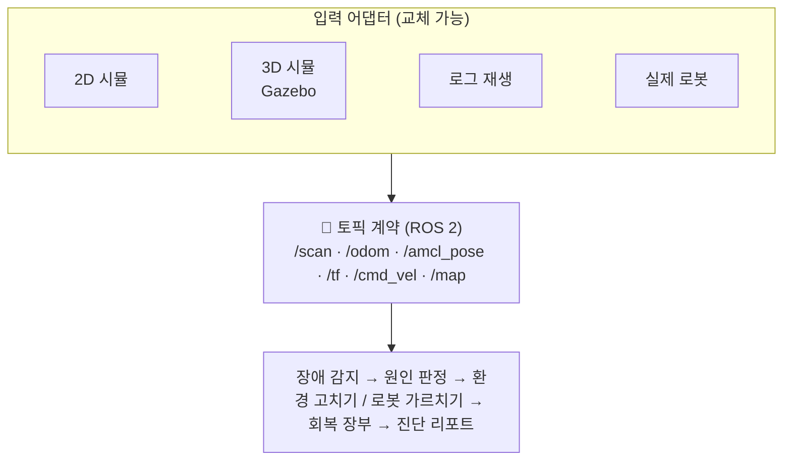
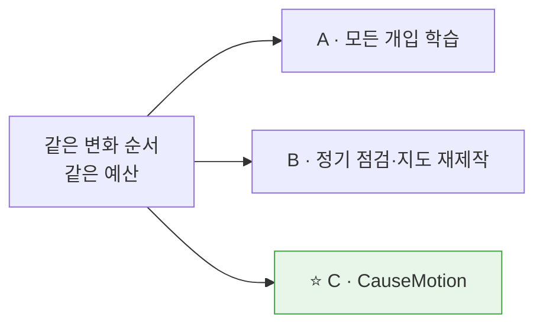
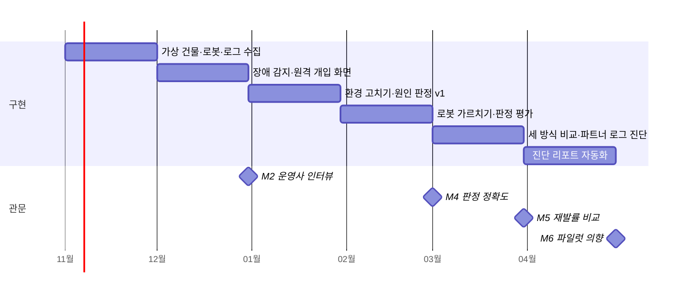
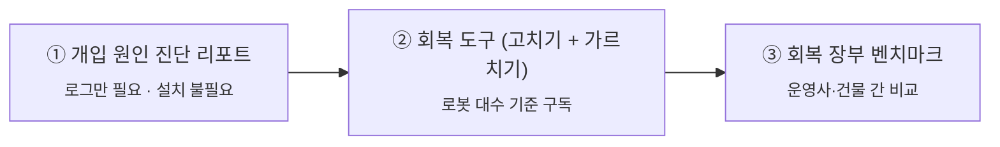

# 🤖 CauseMotion

**로봇이 멈췄을 때, _환경을 고칠 일_ 인지 _로봇이 배울 일_ 인지 가려서 처리합니다.**

건물 서비스 로봇(배송·안내·순찰)을 위한 **현장 회복 엔진**

---

## 💡 한눈에 보기

| 😣 문제 | 💡 아이디어 | 🎯 목표 |
|:--|:--|:--|
| 로봇이 바뀐 환경에서 **반복해서 멈추고**, 원격 개입 기록이 **원인 구분 없이** 전부 학습 데이터로 쓰임 | 멈춤마다 **원인(Cause)** 을 판정해 **환경 수정**과 **선별 학습** 두 갈래로 나눠 처리하고, 다시 움직이게(**Motion**) 함 | 같은 예산에서 "모든 개입 학습" 방식보다 **재발률 30%↓** (잠정) |

---

## ❓ 왜 필요한가

> 로봇이 멈추는 원인 대부분은 **학습으로 해결되지 않습니다.**

| 원인 | 예시 | 학습으로 해결? |
|:--|:--|:--:|
| 🚶 일시적 원인 | 지나가는 사람 무리, 잠시 놓인 카트 | ❌ 기록만 |
| 🗺️ 지도 낡음 | 가구 재배치, 행사, 임시 칸막이 | ❌ 지도 수정 |
| 📷 센서·보정 | 카메라·라이다 위치 틀어짐 | ❌ 보정 |
| 🛗 시설 연동 | 엘리베이터·게이트 응답 실패 | ❌ 시설 수정 |
| 🧠 **정책 부족** | 붐비는 복도에서 반복되는 회피 실패 | ✅ **이것만 학습** |

원인이 아닌 곳에 학습하면 **재발은 그대로, 비용은 증가, 정책은 오히려 나빠질 수 있습니다.**

---

## ⚙️ 어떻게 동작하나

<table>
<tr>
<th width="50%">🛠️ 환경 고치기 (학습 안 함)</th>
<th width="50%">🧠 로봇 가르치기 (골라서 학습)</th>
</tr>
<tr valign="top">
<td>

- **변화 감지** — 고정 변화 vs 일시 변화 구분
- **지도 부분 갱신** — 바뀐 구역만 수정
- **구역별 주행 설정** — 여유 거리·속도 조정
- **보정·시설 티켓** — 담당자에게 정확히 전달

</td>
<td>

- **선별** — '정책 부족' 판정만 후보로
- **검수** — 품질 낮은 원격조정 기록 제외
- **표적 학습** — 해당 상황 유형만 (HG-DAgger)
- **전후 검증** — 성공률 비교, 타 상황 유지 확인

</td>
</tr>
</table>

### 🎚️ 확신도에 따라 다르게 처리

> **원칙** — 싼 조치는 낮은 확신에서도 먼저 시도하고, **학습 투입에는 가장 강한 근거**를 요구합니다. 재발하면 다음 원인 후보로 넘어갑니다.

---

## 📖 예시

| | 🅰️ 환경을 고친 경우 | 🅱️ 로봇을 가르친 경우 |
|:--|:--|:--|
| **상황** | 행사로 로비 소파·안내판 이동 | 점심마다 같은 복도에서 사람 무리 회피 실패 |
| **판정** | 🗺️ 지도 낡음 (확신도 중간) | 🧠 정책 부족 (확신도 높음) |
| **조치** | 로비 구역만 지도 갱신, 학습 제외 | 검수 통과 5건으로 '붐비는 복도 교차' 표적 학습 |

※ 설명용 가상 시나리오

---

## 🏗️ 아키텍처

**입력 어댑터만 바꾸면 같은 코드가 시뮬과 실제 로봇에서 그대로 동작합니다.**

---

## 📊 검증 방법

시뮬레이션에 변화를 일부러 넣어 **원인 정답**을 만들고, 같은 예산으로 세 방식을 비교합니다.

| 지표 | 목표 (잠정) |
|:--|:--|
| 🎯 판정 정확도 | 확신도 '높음' **85%↑**, 전체 **70%↑** |
| 🔁 재발률 | 방식 A 대비 **30%↓** |
| 🧪 기타 | 학습 효율 · 학습 데이터 오염률 · 회복 비용 · 일반화 |

---

## 🗓️ 로드맵 (6개월 · 하드웨어 없이)

이후 **3D 시뮬(Gazebo) → 실제 로봇(이륜 차동구동)** 순으로 확장합니다.

---

## 💼 사업 단계

**차별점** — 다른 기업은 개입을 _모두 학습 데이터로 모으지만_, CauseMotion은 **배울 필요 없는 개입을 걸러 환경 쪽에서 해결**합니다.
변화·개입·원인·조치·재발이 연결된 **회복 장부 데이터**는 아직 공개된 곳이 없습니다.

---

## 🧰 기술 스택

| 영역 | 사용 |
|:--|:--|
| 로봇·시뮬 | ROS 2 Jazzy · Nav2 · Gazebo Harmonic · TurtleBot 4 · HuNavSim |
| 기록·시각화 | rosbag2 (MCAP) · Foxglove |
| 서버·장부 | Python · FastAPI · SQLite / PostgreSQL |
| 학습 | PyTorch |
| 실행 환경 | Ubuntu 24.04 · Docker |

## 🚀 시작하기

> 준비 중입니다.

---

NAVER D2SF 캠퍼스 기술창업 공모전 출품 프로젝트 · 기획 v3 
공개 데이터셋은 라이선스 등급별로 관리하며, 원본 데이터는 이 저장소에 포함하지 않습니다.

